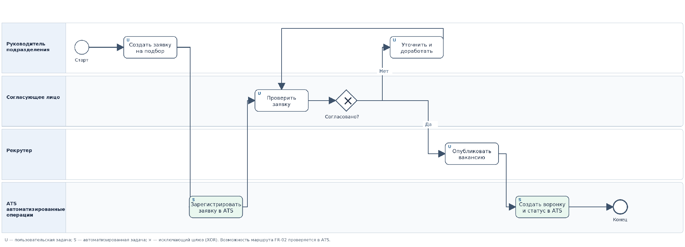
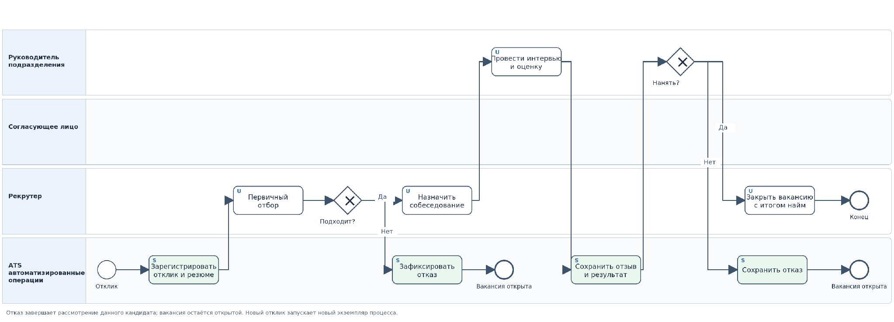

# Концепция информационной системы отбора персонала ООО «ВекторТех»

**Практическая работа № 2 «Разработка концепции информационной системы»**  
**Дисциплина:** «Проектирование информационных систем»  
**Вариант № 15:** «Отбор персонала (подбор кандидатов)»  
**Дата:** 26 октября 2026 г.

| **Участник**       | **Роль в учебной команде** | **Ответственность**                                                             |
|--------------------|----------------------------|---------------------------------------------------------------------------------|
| Митрофанова Полина | Бизнес-/системный аналитик | Разделы 1, 5, 8: описание объекта и требований, AS-IS и TO-BE, критерии приемки |
| Трикула Артём      | Системный архитектор       | Разделы 2–4: обзор аналогов, альтернативы, сравнение и выбор                    |
| Лютый Никита       | Руководитель проекта       | Разделы 6, 7, 9; дорожная карта, финансовая модель, согласование и сборка       |

**Примечание о происхождении исходных данных.** «ВекторТех» — вымышленная организация. Численность, структура HR-отдела, процессы, загрузка, ставки работ, бюджеты, план реализации и прогноз эффекта приняты командой как учебные предположения. Указанные цены подписок поставщиков основаны на опубликованных страницах тарифов по состоянию на 26.10.2026. Функции, описанные поставщиками, не считаются подтвержденными испытаниями или договором.

## 1. Характеристика объекта автоматизации и требования пользователя

### 1.1. Назначение и место работы в жизненном цикле АС

Согласно ГОСТ Р 59793-2021, разработка концепции АС выполняется после формирования требований пользователя и перед подготовкой технического задания. На данной стадии оценивают способы удовлетворения требований, формируют альтернативные решения, сравнивают ресурсы, ограничения и риски и обосновывают предпочтительную концепцию. Концепция определяет какой способ автоматизации целесообразен, но не заменяет техническое задание, детальное проектирование, закупку или эксплуатационные испытания. Для учебной работы этап исследования реализуется как аналитический обзор готовых решений и возможных технологий \[1, 2\].

ООО «ВекторТех» — вымышленная IT-компания, разрабатывающая программное обеспечение. Штат — 250 сотрудников. В подборе персонала участвуют 4 рекрутера и 8 нанимающих руководителей; общее число внутренних пользователей будущей системы — 12. За месяц поступает ориентировочно 200 откликов, архив HR-отдела содержит 3 000 резюме.

Объект автоматизации — бизнес-процесс от формирования потребности в сотруднике и согласования заявки до решения о найме/отказе и закрытия вакансии. Внутри процесса ведутся вакансии, кандидаты, интервью, профессиональные оценки, статусы и отчеты. Профессиональное решение о найме всегда принимает человек. За пределами системы остаются кадровое делопроизводство, расчет зарплаты, оформление трудового договора, адаптация и обучение принятого сотрудника. Личный кабинет внешнего кандидата не обязателен.

**Цель проекта:** создать обоснованную концепцию единой информационной среды, позволяющей уменьшить повторный ввод сведений, снизить вероятность потери истории подбора и обеспечить контролируемое взаимодействие рекрутеров и руководителей при соблюдении требований к персональным данным.

### 1.2. Участники и фактическая последовательность AS-IS (учебная модель)

В существующем процессе руководитель передает заявку рекрутеру через почту или сообщение, согласует профиль вакансии, а рекрутер вручную размещает вакансию и собирает отклики. Резюме, переписки, календарные события и табличные реестры не образуют единого управляемого источника. Оценки после интервью передаются сообщениями, а история этапов редактируется вручную.

| **Шаг AS-IS**             | **Участник**               | **Основная операция**                       | **Инструмент и ограничение**           |
|---------------------------|----------------------------|---------------------------------------------|----------------------------------------|
| 1\. Инициирование подбора | Руководитель               | Формулирует потребность и требования        | Почта/сообщение; неполная форма заявки |
| 2\. Согласование вакансии | Согласующее лицо, рекрутер | Возвращает на уточнение или согласует       | Нет единого журнала согласования       |
| 3\. Поиск                 | Рекрутер                   | Публикует вакансию, собирает отклики        | Несколько площадок и почтовых ящиков   |
| 4\. Учёт                  | Рекрутер                   | Сохраняет файлы, переносит данные в таблицу | Риск дублей и устаревших записей       |
| 5\. Отбор и интервью      | Рекрутер, руководитель     | Проверяют резюме, согласуют встречи         | Разрозненные календари и переписка     |
| 6\. Решение и отчётность  | Руководитель, рекрутер     | Оценивают и фиксируют результат             | Ручное обновление статусов и сводок    |

Шесть ключевых проблем AS-IS: **(P1)** разрозненное хранение; **(P2)** дубли и потери сведений; **(P3)** отсутствие актуальной истории движения кандидатов; **(P4)** задержки согласований и интервью; **(P5)** трудоемкая отчётность; **(P6)** сложность контроля доступа, сроков хранения и удаления персональных данных. В реальном проекте требуется подтвердить их интервью с пользователями и замерами. Здесь они приняты как учебная постановка.

### 1.3. Ограничения заказчика

| **Параметр**                 | **Согласованное значение**                             | **Комментарий**                                 |
|------------------------------|--------------------------------------------------------|-------------------------------------------------|
| Разовые затраты на внедрение | не более 3 500 000 ₽                                   | Не смешивать с TCO за 3 года                    |
| Ежегодная эксплуатация       | не более 500 000 ₽                                     | Отдельный годовой лимит                         |
| Максимальный срок внедрения  | 9 календарных месяцев                                  | Для варианта B планируется 3 месяца             |
| Внутренние пользователи      | 12                                                     | 4 рекрутера и 8 руководителей                   |
| Стартовая база               | 3 000 резюме                                           | Форматы и объём вложений уточняются             |
| Поток новых откликов         | около 200 в месяц                                      | Повторные отклики возможны                      |
| Размещение данных            | базы персональных данных на территории РФ              | Расположение резервных копий уточняется         |
| Информационная безопасность  | применимые нормы 152-ФЗ, контроль прав, резервирование | Не подменяет аудит ИБ                           |
| Горизонт TCO и ROI           | 3 полных года после запуска                            | Индексация и дисконтирование в модели не учтены |

Для сравнения вариантов дополнительно принято, что рабочие станции, корпоративная почта и календари уже существуют. Обычные расходы на размещение вакансий и штатная работа рекрутеров, общие для всех вариантов, не включаются в TCO ИС; изменение времени их административной работы оценивается отдельно как эффект, чтобы не возникал двойной счёт.

### 1.4. Реестр требований и приоритеты

Приоритет **Must** означает обязательное условие допуска к внедрению; **Should** — важную, но необязательную функцию; **Could** — перспективное развитие. Наличие возможности в рекламе поставщика не равно подтвержденному выполнению конкретного сценария. Полная матрица соответствия FR-01–FR-17 и NF-01–NF-08 находится в приложении А.

| **Код** | **Функциональное требование**                                    | **Приоритет** |
|---------|------------------------------------------------------------------|---------------|
| FR-01   | Создание, редактирование и просмотр вакансий                     | Must          |
| FR-02   | Регистрация заявки на подбор и фиксация маршрута её согласования | Must          |
| FR-03   | Создание, хранение и просмотр карточки кандидата                 | Must          |
| FR-04   | Прикрепление резюме и разрешённых документов                     | Must          |
| FR-05   | Поиск/фильтрация по навыкам, опыту, должности                    | Must          |
| FR-06   | Учёт этапов отбора и статусов кандидата                          | Must          |
| FR-07   | Связь кандидата с одной или несколькими вакансиями               | Must          |
| FR-08   | Планирование интервью и регистрация результатов                  | Must          |
| FR-09   | Просмотр кандидатов и фиксация оценки нанимающим руководителем   | Must          |
| FR-10   | Фиксация найма, отказа, продолжения поиска, закрытия вакансии    | Must          |
| FR-11   | Регулярные и сводные отчёты по подбору                           | Should        |
| FR-12   | Разграничение доступа по ролям и назначенным вакансиям           | Must          |
| FR-13   | История значимых действий и изменений                            | Should        |
| FR-14   | Импорт начальной базы 3 000 резюме из согласованного формата     | Must          |
| FR-15   | Уведомления и напоминания                                        | Should        |
| FR-16   | Интеграция с hh.ru                                               | Could         |
| FR-17   | Автоматический анализ резюме                                     | Could         |

В рамках обязательного FR-02 под согласованием понимается сохранение решения уполномоченного лица и возможность возврата заявки на доработку; электронная подпись и кадровое согласование в него не входят. FR-10 исправлен относительно первоначального текста аналитика: используется «продолжение отбора», а не ошибочное «предложение отбора».

### 1.5. Нефункциональные требования

| **Код** | **Требование**                                         | **Критерий проверки**                                               |
|---------|--------------------------------------------------------|---------------------------------------------------------------------|
| NF-01   | Работа 12 внутренних пользователей                     | Проверка параллельных типовых сценариев                             |
| NF-02   | Работа со стартовыми 3 000 резюме и 200 откликами/мес. | Импорт и проверка обработки тестового набора                        |
| NF-03   | Производительность                                     | Не более 3 с для 95% типовых операций при нагрузке NF-01            |
| NF-04   | Доступность                                            | Не менее 99,5% за месяц за вычетом согласованных окон ТО            |
| NF-05   | Размещение и законная обработка ПДн                    | Проверка договорных документов и фактической конфигурации           |
| NF-06   | Роли, аудит действий и защищённая передача             | Позитивные/негативные сценарии доступа и журнал                     |
| NF-07   | Резервное копирование и восстановление                 | Регламент, демонстрация восстановления или подтверждение поставщика |
| NF-08   | Переносимость данных и сопровождение                   | Согласованный экспорт, настройка справочников и статусов            |

Требования к обработке данных кандидатов включают законные основания обработки, информирование при необходимости, порядок удаления, ограничение доступа и соглашения с поставщиком. Условие локализации баз данных граждан РФ рассматривается с учётом применимой редакции ч. 5 ст. 18 закона № 152-ФЗ \[8\]; наличие сервера в РФ само по себе ещё не подтверждает законность всех операций.

## 2. Аналитический обзор аналогов и готовых решений

### 2.1. Цель обзора и методика

Обзор необходим, чтобы выбрать **представителя альтернативы B — готовой ATS** для дальнейшего сравнения с организационным подходом и собственной разработкой. ATS (Applicant Tracking System) — программная система управления вакансиями и ходом отбора кандидатов. Рассмотрены четыре решения: Talantix, Хантфлоу, Поток Рекрутмент и FriendWork. Для всех сопоставляются функции, опубликованные цены, лицензирование, интеграции, требования к хранению данных и неподтвержденные параметры. Источники — официальные страницы поставщиков \[3–7\].

### 2.2. Сопоставление тарифов и возможностей

| **ATS и тариф**             | **Цена в год** | **Заявленные возможности**                                                                           | **Что уточнить**                                                                                   |
|-----------------------------|----------------|------------------------------------------------------------------------------------------------------|----------------------------------------------------------------------------------------------------|
| Talantix «Оптимальный»      | **192 000 ₽**  | Вакансии, база, воронки, работа с заказчиками, заявки и маршруты согласований, интеграция hh.ru, API | Точная матрица доступа восьми руководителей, календарный сценарий, восстановление, формат миграции |
| Хантфлоу «Профессиональный» | 300 000 ₽      | Воронки, взаимодействие с заказчиками, API, аналитика и инструменты совместной работы                | Права, интеграции в тарифе, миграция и платные услуги                                              |
| Поток «Стандартный»         | 288 000 ₽      | База кандидатов, этапы, импорт, отчёты и интеграционные механизмы                                    | Состав подключаемых систем, цена дополнительных услуг                                              |
| FriendWork «Стандартный»    | **188 400 ₽**  | Карточки, совместная работа и интеграции (часть функций зависит от тарифа)                           | Доступ руководителей, согласование заявок, география хранения и безопасность                       |

Для FriendWork принята текущая опубликованная ставка **47 100 ₽ за рекрутера в год**, следовательно, 47 100 × 4 = 188 400 ₽. Это исправление относительно предыдущего отчёта (211 200 ₽). На странице присутствует уведомление о повышении с 15.09.2026; поэтому ставку необходимо подтвердить коммерческим предложением до закупки \[7\]. Указанные суммы относятся только к подпискам, не включают внедрение и регулярное внутреннее сопровождение. Цена за пользователей-руководителей, если она не установлена документально, не считается равной нулю.

### 2.3. Проверка размещения данных и интеграций

Поставщик Talantix сообщает о размещении данных в московском ЦОД и описывает инструменты работы с согласиями и защищенной передачей данных. Для выбранного тарифа «Оптимальный» публичная страница прямо называет **индивидуальные шаблоны заявок, этапы и сценарии согласований**, а также включенную миграцию кадрового резерва. Это подтверждает **заявленное существование функции FR-02**, но не доказательство соответствия собственному маршруту «ВекторТех»: демонстрация конфигурации до договора остаётся обязательной \[3, 4\].

Для Хантфлоу производитель сообщает о российских площадках размещения и мерах защиты. «Поток» заявляет о российском хранении и резервировании. Для FriendWork в использованных материалах не получено достаточного подтверждения всех условий размещения и стоимости доступа восьми руководителей. Неизвестное условие не интерпретируется как нарушение или подтверждение; его статус — «требует проверки».

### 2.4. Предварительный результат обзора

Talantix «Оптимальный» выбран **в качестве представителя готовой ATS**, поскольку его опубликованный тариф для 4 рекрутеров, доступ заказчиков и заявленные инструменты HR-процесса обеспечивают хорошее покрытие исходных задач. Однако победитель всего проекта определяется не в обзоре, а только после проверки Must и многокритериальной оценки в разделе 4. При отрицательном результате проверки обязательного сценария рассматривается другой продукт в альтернативе B, а не игнорируется требование.

## 3. Альтернативные варианты концепции

### 3.1. Общие границы и принцип расчета

Сравниваются содержательно разные способы организации процесса: **A — улучшение регламентов и таблиц без новой ATS**, **B — внедрение Talantix с настройкой**, **C — разработка корпоративного веб-приложения**. Все опираются на одну нагрузку (12 пользователей, 3 000 резюме, 200 откликов в месяц), одни обязательные требования и годовые лимиты заказчика. Варианты оцениваются по первоначальным затратам, эксплуатации и трёхлетнему TCO. Ресурсные оценки вымышлены, но их структура объяснена и проверяема.

### 3.2. Альтернатива A — таблицы, файловый архив и регламенты

Существующие офисные инструменты сохраняются. Рекрутеры ведут один реестр вакансий и кандидатов, создают идентификаторы, используют стандартизированные карточки, шаблоны отзывов, контрольные статусы и календарь. Резюме размещаются на корпоративном файловом сервере в РФ. Руководители получают доступ к папкам только своих вакансий; выгрузки данных и актуализацию реестра выполняют рекрутеры. Маршруты согласования заявок документируются по регламенту.

**Плюсы:** низкая стоимость, минимальные сроки запуска, привычные инструменты и независимость от ATS-поставщика. **Минусы:** повторный ручной ввод, дубли, ограничения разграничения доступа до уровня отдельных файлов/папок, слабая автоматизация уведомлений и интеграций. A не объявляется заведомо непригодным: ручная реализация Must допустима в принятой концепции, если проверкой подтверждены требуемые результаты и контроль доступа. При более строгой трактовке обязательности автоматизации пришлось бы пересмотреть его допуск.

План реализации: **2 месяца**, трудоёмкость **1,40 чел.-мес.**; первоначальные затраты **280 000 ₽**; ежегодные расходы **150 000 ₽**. TCO = 280 000 + 3 × 150 000 = **730 000 ₽**.

### 3.3. Альтернатива B — Talantix «Оптимальный» с настройкой

Готовая ATS становится централизованной средой хранения вакансий, карточек кандидатов, прикрепленных резюме, воронки отбора, интервью и оценок. Четыре рекрутера получают оплачиваемые лицензии, восемь руководителей — аккаунты заказчиков в пределах подтверждённых функций и прав. Система интегрируется с hh.ru в поддерживаемом объёме; заявки и согласования настраиваются по доступным шаблонам. Окончательный выбор кандидата всегда остаётся за руководителем.

**Плюсы:** готовая специализированная логика, единая история, сравнительно быстрое внедрение, поддержка поставщика, возможность использовать API. **Минусы:** зависимость от поставщика, тарифа, доступности облака, ограничений API и правил хранения данных. До заключения договора требуется проверить конкретный маршрут FR-02, права доступа, миграцию 3 000 резюме, резервирование и экспорт, а также отсутствие скрытых регулярных платежей. Услуга переноса, заявленная поставщиком в тарифе, не должна дублироваться в смете как отдельный внешний платеж: смета внедрения включает **внутренние работы по подготовке/сверке и интеграциям**.

План реализации: **3 месяца**, трудоёмкость **2,05 чел.-мес.**; разовые затраты **400 000 ₽**; эксплуатация **330 000 ₽/год**, в том числе 192 000 ₽ подписки; TCO = 400 000 + 3 × 330 000 = **1 390 000 ₽**.

### 3.4. Альтернатива C — собственное веб-приложение

Разрабатывается модульный монолит с веб-интерфейсом, серверным приложением, PostgreSQL и файловым хранилищем на инфраструктуре в РФ. В первой версии предусмотрены вакансии, кандидаты, связь кандидат–вакансия, статусы, поиск, интервью, отзывы, согласование заявок, роли, журналирование, импорт/экспорт и базовая аналитика. Микросервисы, интеллектуальное ранжирование и мобильное приложение исключены из базового объёма как непропорциональные учебной нагрузке. Интеграция с hh.ru проектируется лишь при наличии согласованного API.

**Плюсы:** контроль бизнес-логики, возможность точно реализовать маршруты согласований, права и форматы интеграций, отсутствие обязательной лицензии ATS. **Минусы:** максимальные инвестиции, ответственность за безопасность и поддержку, более поздний эффект, риск срыва сроков и роста стоимости. Смета относится к коммерческой разработке производственного качества — не к студенческому прототипу из нескольких страниц. Суммарные 11,5 человеко-месяца могут выполняться параллельно несколькими ролями за восемь календарных месяцев.

План реализации: **8 месяцев**, трудоёмкость **11,50 чел.-мес.**; разовые затраты **3 000 000 ₽**; эксплуатация **480 000 ₽/год**; TCO = 3 000 000 + 3 × 480 000 = **4 440 000 ₽**. Запас до годового лимита эксплуатации — лишь 20 000 ₽, поэтому большие новые функции потребуют пересмотра бюджета.

### 3.5. Ресурсы и укрупнённая архитектура

| **Показатель**                                | **A: таблицы**                         | **B: Talantix**        | **C: разработка**             |
|-----------------------------------------------|----------------------------------------|------------------------|-------------------------------|
| Трудоёмкость, чел.-мес.                       | 1,40                                   | 2,05                   | 11,50                         |
| План внедрения                                | 2 мес.                                 | 3 мес.                 | 8 мес.                        |
| Разовые затраты                               | 280 000 ₽                              | 400 000 ₽              | 3 000 000 ₽                   |
| Ежегодная эксплуатация                        | 150 000 ₽                              | 330 000 ₽              | 480 000 ₽                     |
| Сумма разовых расходов и полного первого года | 430 000 ₽                              | 730 000 ₽              | 3 480 000 ₽                   |
| **TCO за три года**                           | **730 000 ₽**                          | **1 390 000 ₽**        | **4 440 000 ₽**               |
| Технологический принцип                       | Корпоративные таблицы и файловые права | Готовая облачная ATS   | Модульный монолит, PostgreSQL |
| Контрольный риск                              | Версионность, ручной труд              | SLA, права и поставщик | Дефекты, поддержка и сроки    |

В модели TCO все суммы рассчитаны на три полных года работы после запуска. Это сопоставимая оценка стоимости владения, а не бюджет проекта на дату старта: часть платежей за подписку может потребоваться до начала пилота. Подробные исходные трудозатраты, формирование статей и резервов приведены в приложении Б.

## 4. Сравнение концепций и обоснование выбора

### 4.1. Проверка обязательных условий до выставления баллов

Проверка проходит в два этапа. Сначала альтернативы сравниваются с жесткими численными ограничениями (до 3,5 млн ₽ внедрение, до 500 тыс. ₽/год эксплуатация, до 9 мес. срок). Все три варианта этим пределам соответствуют. Затем проверяется **наличие проектного пути выполнения Must** и фиксируются неустановленные условия. Описанная возможность не равна испытанной; принятие концепции не дает права закупать или вводить ее без проверки.

| **Группа обязательных требований**  | **A**                                      | **B: Talantix**                                                     | **C**                                   |
|-------------------------------------|--------------------------------------------|---------------------------------------------------------------------|-----------------------------------------|
| Вакансии, карточки, статусы, поиск  | Табличный регламент (ручное выполнение)    | Заявленные функции ATS; проверить сценарии                          | Предусмотренные модули; нужны испытания |
| Заявки и маршрут согласования FR-02 | Журнал решений по регламенту               | Шаблоны и сценарии **заявлены**; проверить конфигурацию             | Проектируемый маршрут                   |
| Интервью, отзывы, решения           | Календарь и шаблоны                        | Возможности заявлены; проверить права                               | Проектируемые функции                   |
| Права руководителей FR-12           | Папки по вакансиям, проверка достаточности | Проверить точную матрицу и отрицательные сценарии                   | Проектируемые ролевые ограничения       |
| Импорт 3 000 резюме FR-14           | Очистка и регламент                        | Заявленная миграция; тестовый импорт и сверка                       | Проектируемый импорт; тестирование      |
| РФ, ПДн, копии                      | Проектные меры, проверка                   | Часть условий заявлена; договор, копии и восстановление — проверить | Проектные меры, аудит и испытания       |

Ни одно решение не исключено лишь на основании отсутствия фактических испытаний на стадии концепции. Однако **для внедрения** непрохождение любого Must закрывает выбранную конфигурацию, даже если её итоговый балл самый высокий. Полная построчная матрица требований находится в приложении А. Отдельного внимания требуют FR-02 и FR-12: их полное выполнение в B должно быть продемонстрировано до принятия финансовых обязательств перед поставщиком.

### 4.2. Метод взвешенных оценок и смысл критериев

Итоговая экспертная оценка концепции рассчитывается как сумма произведений веса критерия на оценку варианта по пятибалльной шкале: **Sᵢ = Σ wⱼ × sᵢⱼ**, где Σwⱼ = 1. Наибольшее Sᵢ соответствует предпочтительному варианту среди условно допустимых. Веса выбраны командой **до** оценки: полнота автоматизации — 0,30; TCO — 0,20; срок — 0,15; удобство — 0,15; безопасность — 0,10; интеграции — 0,10.

Шкала фиксирована для каждого критерия. В K1 высокий балл означает автоматизацию большего числа сценариев, в K2 — меньший TCO, в K3 — более быстрый запуск. K4 характеризует удобство взаимодействия сотрудников (не дублирует K1), K5 — степень проработанности и подтверждения защиты, K6 — готовность интеграций. Полные пороги и правила выставления баллов приведены в приложении В. Пять баллов за функции или безопасность не присваиваются лишь по рекламным заявлениям без испытаний.

### 4.3. Взвешенная оценка

| **Критерий**                            | **Вес**  | **A**    | **B**    | **C**    |
|-----------------------------------------|----------|----------|----------|----------|
| K1. Покрытие требований и автоматизация | 0,30     | 2        | 4        | 4        |
| K2. TCO за 3 года                       | 0,20     | 5        | 4        | 1        |
| K3. Срок внедрения                      | 0,15     | 5        | 4        | 2        |
| K4. Удобство пользователей              | 0,15     | 2        | 4        | 3        |
| K5. Безопасность                        | 0,10     | 3        | 3        | 3        |
| K6. Возможности интеграции              | 0,10     | 1        | 4        | 3        |
| **Итог Sᵢ**                             | **1,00** | **3,05** | **3,90** | **2,75** |
| **Место**                               | —        | **2**    | **1**    | **3**    |

Пример расчёта для B: 0,30 × 4 + 0,20 × 4 + 0,15 × 4 + 0,15 × 4 + 0,10 × 3 + 0,10 × 4 = **3,90**. A выигрывает по цене и сроку, однако проигрывает по автоматизации и интеграциям. C способна охватить необходимые функции, но её преимущества в настройке не перекрывают оцененные расходы и более длительный запуск. Одинаковые три балла за безопасность отражают отсутствие испытаний для всех трех альтернатив.

### 4.4. Проверка устойчивости результата

Методичка требует проверить устойчивость при изменении веса наиболее важного критерия на ±0,05. Наиболее важен K1 (w₁ = 0,30). Он меняется до 0,25 и 0,35, а остальные веса умножаются на коэффициент **(1 − w′₁) / (1 − 0,30)**. Таким образом сумма весов остается 1, а относительный приоритет остальных критериев сохраняется.

| **Вес K1** | **S(A)** | **S(B)** | **S(C)** | **Лидер** |
|------------|----------|----------|----------|-----------|
| 0,25       | 3,1250   | 3,8929   | 2,6607   | B         |
| 0,30       | 3,0500   | 3,9000   | 2,7500   | B         |
| 0,35       | 2,9750   | 3,9071   | 2,8393   | B         |

Лидерство B сохраняется, следовательно, выбор **локально устойчив** к проверенному изменению веса. Это не доказывает устойчивость ко всем будущим изменениям тарифов, требований, сроков или экспертных оценок. Тест не может компенсировать неподтвержденное Must-требование.

### 4.5. Выбор концепции и условия окончательного допуска

**Для дальнейшего проектирования выбирается B — Talantix «Оптимальный» с настройкой под «ВекторТех».** Итоговый балл B равен 3,90 против 3,05 у A и 2,75 у C. Трёхлетний TCO B на 660 000 ₽ выше A, но A сохраняет существенный ручной труд. По сравнению с C готовая ATS дешевле на 3 050 000 ₽ по TCO и запускается на пять календарных месяцев раньше. Поэтому дополнительные возможности C в данной постановке не оправдывают разницу затрат.

Условиями перехода к реализации B являются: подтверждение согласования заявок FR-02 в тарифе и проектной настройке; проверка доступа руководителей к назначенным вакансиям; успешная пробная миграция и сверка 3 000 резюме; договорная проверка обработки, хранения и удаления данных; доказанный порядок резервирования/восстановления; подтверждение полной цены подписки и необходимых интеграций. При отрицательном результате сначала рассматриваются другие доступные ATS (включая рассмотренные в разделе 2), затем при необходимости проводится повторный выбор между альтернативами. Технико-экономическую целесообразность B дополнительно проверяет раздел 6.

## 5. Описание выбранной концепции и модель TO-BE

### 5.1. Границы выбранной ATS и распределение операций

После внедрения единая ATS выступает основным источником данных по вакансиям, кандидатам, этапам и оценкам. Владелец вакансии инициирует потребность, рекрутер сопровождает подбор, согласующее лицо подтверждает заявку. ATS должна сохранять статус заявки, изменения карточек, участие сотрудников и результаты. Рекрутер организует интервью с использованием возможностей настроенной системы; руководство принимает профессиональное решение. Система не выбирает кандидатов автоматически и не оформляет трудовой договор.

| **Операция**          | **Автоматизированная часть**                                         | **Человек и ответственность**                           |
|-----------------------|----------------------------------------------------------------------|---------------------------------------------------------|
| Заявка на вакансию    | Регистрация, маршрут, хранение решения при проверенном FR-02         | Руководитель вводит параметры; согласующее лицо решает  |
| Публикация и отклики  | Сохранение заявки/вакансии, импорт поддерживаемых откликов           | Рекрутер публикует, проверяет корректность поступления  |
| Первичный отбор       | Фильтры и статусы, история                                           | Рекрутер оценивает резюме                               |
| Интервью и отзывы     | Планирование, уведомления, сохранение результатов в доступном объёме | Рекрутер договаривается, руководитель проводит оценку   |
| Решение о найме       | Фиксация статуса, журнал и отчёт                                     | Нанимающий руководитель принимает решение               |
| Контроль безопасности | Роли, аудит и резервирование при подтверждении                       | Администратор и ответственное лицо проверяют исполнение |

### 5.2. Целевой процесс TO-BE: согласование и запуск вакансии

*Рисунок 1. BPMN 2.0 — согласование заявки и запуск вакансии*

**Рисунок 1.** Согласование заявки и запуск вакансии с участием руководителя, согласующего лица, рекрутера и ATS. Использованы начальное и конечное события, пользовательские и сервисные задачи, исключающий шлюз. Если заявку не согласовали, она возвращается инициатору на уточнение; это **не** означает поиск нового кандидата. Ветвь возвращается на повторную проверку после доработки. Публикация выполняется только после положительного решения.

### 5.3. Целевой процесс TO-BE: обработка отклика и решение

*Рисунок 2. BPMN 2.0 — обработка кандидата и завершение решения*

**Рисунок 2.** Отбор конкретного кандидата. При несоответствии на первом этапе или отрицательном решении после интервью в ATS фиксируется отказ; **данный экземпляр процесса заканчивается, вакансия остаётся открытой**. Новый отклик запускает новый экземпляр процесса, поэтому отсутствует некорректный переход к пересогласованию исходной заявки. При положительном решении фиксируется найм и закрывается вакансия. Ручные и автоматизированные задачи обозначены разными маркерами.

Модель является **целевой**, а не изображением уже проверенного внедрения. Операции заявки и ролевого доступа должны быть подтверждены на этапе проверки Talantix. Для защиты BPMN важна именно логика шлюзов: исходящим путям соответствуют условия, а после отказа не запускаются одновременно несовместимые действия.

### 5.4. Изменения по отношению к AS-IS и границы интеграций

| **Проблема AS-IS**               | **Изменение TO-BE**                      | **Контроль эффекта**                                  |
|----------------------------------|------------------------------------------|-------------------------------------------------------|
| P1–P2: разрозненные файлы, дубли | Единая карточка и правила загрузки       | Доля откликов с корректной карточкой; контроль дублей |
| P3: неясный статус               | Единая воронка и журнал изменений        | Актуальность статуса за рабочий день                  |
| P4: задержки согласований        | Маршруты заявок/назначений и напоминания | Время прохождения согласования и интервью             |
| P5: ручные сводки                | Стандартные отчёты из ATS                | Время подготовки отчета                               |
| P6: избыточный доступ            | Настроенные права и регламент хранения   | Негативные тесты доступа и аудит                      |

Интеграция с hh.ru обозначена как дополнительная, поскольку зависит от интерфейсов и условий доступа. Незаявленные или непроверенные интеграции с корпоративным календарём не считаются обязательными автоматическими функциями. При сбоях интеграции допускается контролируемый ручной импорт и дальнейшая работа через ATS, если это согласовано регламентом.

## 6. Ожидаемые эффекты и технико-экономическое обоснование

### 6.1. Расчетная база AS-IS

Одинаковая для всех альтернатив исходная база состоит из трёх повторяющихся административных операций. Учебные допущения: 200 откликов ежемесячно, 35 интервью в месяц, 12 минут ручного оформления отклика, 20 минут координации интервью, 4 часа подготовки отчетов одним рекрутером в месяц и полная стоимость рабочего часа 1 200 ₽. Стоимость часа в модели включает условные расходы работодателя и не является тарифом внешнего подрядчика.

| **Операция**                  | **Годовой расчёт**     | **Время, часов/год** |
|-------------------------------|------------------------|----------------------|
| Ручная обработка откликов     | 200 × 12 мин × 12 / 60 | 480                  |
| Организация интервью          | 35 × 20 мин × 12 / 60  | 140                  |
| Отчетность четырех рекрутеров | 4 × 4 ч × 12           | 192                  |
| **Всего**                     |                        | **812**              |

Денежный эквивалент: 812 × 1 200 = **974 400 ₽/год**. Это **не** гарантированное сокращение фонда оплаты труда. Экономия возникает только если освобожденное время используется продуктивно либо позволяет избежать дополнительных затрат при росте нагрузки.

### 6.2. TCO, годовой эффект и сравнение

Для учебного прогноза приняты экспертные доли сокращения перечисленной ручной работы: A — **20%**, B — **65%**, C — **75%**. Для B это означает снижение времени с 812 до 284,2 ч/год, то есть высвобождение **527,8 ч/год** (примерно 44 ч/месяц для всего отдела). Целевой коэффициент должен быть подтверждён замерами пилота; отдельной статистики реального предприятия нет.

**TCO = Cсозд + 3 × Cэкспл; E = H₀ × 1 200 × q**, где H₀ = 812 ч/год, q — доля сокращения трудозатрат.

| **Показатель**                      | **A**         | **B**           | **C**           |
|-------------------------------------|---------------|-----------------|-----------------|
| Сокращение рассматриваемого времени | 20%           | 65%             | 75%             |
| Высвобождение, ч/год                | 162,4         | 527,8           | 609,0           |
| Годовой эффект E                    | 194 880 ₽     | 633 360 ₽       | 730 800 ₽       |
| Разовые затраты                     | 280 000 ₽     | 400 000 ₽       | 3 000 000 ₽     |
| Эксплуатация/год                    | 150 000 ₽     | 330 000 ₽       | 480 000 ₽       |
| **TCO (3 года)**                    | **730 000 ₽** | **1 390 000 ₽** | **4 440 000 ₽** |

### 6.3. Окупаемость и ROI

Упрощенный срок окупаемости рассчитывается как **Tок = Cсозд/(E − Cэкспл)** при положительном чистом годовом эффекте. **ROI = (3E − TCO)/TCO × 100%**. Чистый трехлетний эффект равен 3E − TCO. Расчет не учитывает дисконтирование, динамику заработных плат, стоимость альтернативного использования денег и индексацию тарифов; в учебной концепции это явно оговоренные упрощения.

| **Показатель**          | **A**      | **B**                      | **C**        |
|-------------------------|------------|----------------------------|--------------|
| Суммарный эффект 3E     | 584 640 ₽  | 1 900 080 ₽                | 2 192 400 ₽  |
| Чистый эффект за 3 года | −145 360 ₽ | **+510 080 ₽**             | −2 247 600 ₽ |
| Срок окупаемости        | 6,24 года  | **1,32 года (≈15,8 мес.)** | 11,96 года   |
| ROI за 3 года           | −19,91%    | **+36,70%**                | −50,62%      |

Таким образом, среди сравниваемых альтернатив **B единственная с положительным трёхлетним ROI в принятой модели**. Это не доказывает фактическое сокращение денежных расходов: менеджмент должен обеспечить использование освобождённого времени, а исполнитель проекта — проверку KPI в пилоте. Вариант A имеет меньший TCO, однако недостаточно снижает административную нагрузку; у C стоимость собственных работ сильно превышает дополнительный эффект по сравнению с готовой ATS.

### 6.4. Чувствительность к недостижению эффекта

При снижении расчетного эффекта B на 20% (из-за меньшего фактического сокращения рабочего времени) годовая экономия составит 633 360 × 0,8 = **506 688 ₽**, трехлетний ROI = (3 × 506 688 − 1 390 000) / 1 390 000 × 100% = **9,36%**. Положительный, но существенно более скромный результат подтверждает необходимость измерений. Точка безубыточности B по трёхлетнему ROI достигается при E ≥ 1 390 000/3 ≈ 463 333 ₽/год, что соответствует сокращению примерно **47,55%** исходных расходов на административное время. Это расчетный порог для принятого горизонта, а не требование к фактическому увольнению сотрудников.

### 6.5. Неденежные эффекты и KPI

| **Ожидаемый эффект**           | **Измеримый показатель**                        | **Учебная цель**       | **Проверка**                           |
|--------------------------------|-------------------------------------------------|------------------------|----------------------------------------|
| Единая база                    | Доля откликов, имеющих полноценную карточку     | ≥ 99%                  | Сверка журналов откликов и карточек    |
| Актуальность статусов          | Статус обновлен в течение рабочего дня          | ≥ 95%                  | Выгрузка истории переходов             |
| Снижение ручной координации    | Сокращение времени относительно AS-IS           | ≥ 65%                  | Замеры на выборке до и после пилота    |
| Прозрачность подбора           | Вакансии с сохраненной историей основных этапов | 100% закрытых вакансий | Выборочная проверка                    |
| Подготовленность пользователей | Пользователи, прошедшие обучение                | 100% из 12             | Реестр обучения и контрольные сценарии |

Показатели являются **целевыми**, а не достигнутыми. Для первых месяцев пилота допустим мониторинг отклонений без объявления проекта проваленным: вопросы качества данных и принятия сотрудниками рассматриваются в реестре рисков.

## 7. Оценка рисков проекта и меры реагирования

### 7.1. Метод и приоритеты

Риски варианта B оцениваются по вероятности **P** и влиянию **I** по шкале 1–5. Интегральный уровень **R = P × I**: низкий — 1–7, средний — 8–14, высокий — 15–25. Уровень задает приоритет профилактики; стратегия может включать снижение, передачу части обязательств поставщику, избегание и принятие остаточного риска. Риск, для которого невозможен контроль обязательного требования, не компенсируется высоким экономическим баллом.

| **№** | **Риск (категория)**                    | **P** | **I** | **R**  | **Меры предотвращения и реагирования**                                        | **Владелец**     |
|-------|-----------------------------------------|-------|-------|--------|-------------------------------------------------------------------------------|------------------|
| 1     | Ошибки миграции 3 000 резюме (тех.)     | 3     | 4     | 12     | Очистка, тестовый импорт, сверка полей и вложений, исходная копия             | Архитектор       |
| 2     | Утечка данных кандидатов (ИБ)           | 3     | 5     | **15** | Минимальные права, журнал, защита учётных записей, план инцидента             | Архитектор / ИБ  |
| 3     | Нарушение требований к ПДн (право)      | 3     | 5     | **15** | Проверка оснований обработки, договоров, хранения, удаления и локализации     | Аналитик / юрист |
| 4     | Недоступность облачной ATS (тех.)       | 2     | 4     | 8      | Контроль договорного SLA, резервный рабочий регламент, обращение к поставщику | Архитектор       |
| 5     | Низкая вовлеченность персонала (орган.) | 4     | 3     | 12     | Пилот, инструкции, обучение, ответственное лицо от HR                         | Аналитик         |
| 6     | Неподтверждение FR-02/ролей (функц.)    | 3     | 5     | **15** | Демонстрация до договора; при неуспехе — смена ATS                            | Архитектор       |
| 7     | Рост тарифа и доп. лицензий (фин.)      | 3     | 3     | 9      | Сверка коммерческого предложения, условия продления и резерв                  | Руководитель     |
| 8     | Задержка запуска (орган.)               | 3     | 3     | 9      | Вехи, ответственные, резерв времени, приоритет Must                           | Руководитель     |
| 9     | Дубли/низкое качество базы (данные)     | 3     | 3     | 9      | Проверки форматов, дедупликация и контрольная выборка                         | Аналитик         |
| 10    | Эффект ниже 65% (эконом.)               | 3     | 4     | 12     | Замеры, мониторинг KPI, коррекция регламента работы                           | Руководитель     |

Три высоких риска (№ 2, 3, 6) являются **контрольными**: до запуска должны быть получены документальные свидетельства достаточности мер. Выбор стратегии «снизить» не означает полного исчезновения риска. Если права на данные не удается реализовать, применяется стратегия избегания — отказ от данной конфигурации с оценкой другой ATS.

### 7.2. Регулярный мониторинг

Руководитель проекта проводит еженедельную проверку рисков в течение внедрения: статус профилактических мер, наличие новых обстоятельств, потребность в эскалации и изменение ответственного. После запуска мониторинг безопасности и доступности передается уполномоченным представителям организации, а эффективность HR-процесса — руководителю HR-отдела. Риск повышения тарифов пересматривается перед очередным периодом подписки. Каждый инцидент фиксируется с причиной, действием и итогом.

## 8. Показатели качества, порядок оценки и условия приемки

### 8.1. Измеримые показатели для следующей стадии

| **Показатель**         | **Целевое значение**                                                        | **Способ проверки**                              |
|------------------------|-----------------------------------------------------------------------------|--------------------------------------------------|
| Функциональная полнота | 100% согласованных Must, включая FR-02, FR-12, FR-14                        | Матрица требований и приёмочные сценарии         |
| Время типовых операций | ≤ 3 с в 95% случаев при 12 пользователях                                    | Нагрузочный тест с фиксацией перцентиля          |
| Работа с данными       | Успешный импорт и выборочная сверка 3 000 резюме                            | Протокол миграции, проверка атрибутов и вложений |
| Доступность            | ≥ 99,5% за месяц, кроме согласованных ТО                                    | Договорные условия, история мониторинга          |
| Доступ руководителей   | Отсутствие доступа к чужим вакансиям/резюме                                 | Негативные ролевые тесты                         |
| Восстановление         | Резервирование по согласованному расписанию и подтвержденное восстановление | Документированный тест/отчет поставщика          |
| Работа с ПДн           | Подтвержденные размещение в РФ и договорные меры обработки                  | Документы поставщика, аудит конфигурации         |

Требуемая доступность 99,5% — целевая величина проекта, а не уже подтверждённое обязательство Talantix. Ее необходимо проверить по договору; иначе целевое значение должно быть согласовано или выбран другой способ реализации. Точное число одновременных пользователей и набор операций закрепляются в сценарии тестирования. Максимум времени не подменяется средним: используется 95-й перцентиль.

### 8.2. Укрупнённая программа приёмки

1.  **Проверка допустимости:** договор, роли 4 рекрутеров и 8 руководителей, настройка FR-02, локализация, порядок резервирования, полный набор лицензий.

2.  **Функциональные проверки:** заявка и согласование; создание вакансии; импорт кандидата и прикрепление резюме; фильтр; интервью; сохранение оценки; отказ/найм; отчётность.

3.  **Проверка миграции:** пробный импорт и сверка 3 000 карточек, разрешение дублей, сохранность файлов и доступность разрешённым ролям.

4.  **Безопасность и отказоустойчивость:** отрицательные ролевые сценарии, журналирование, правила обработки и удаления ПДн, подтверждение процедур восстановления.

5.  **Нагрузка и пилот:** испытание для 12 пользователей, обучение двух внутренних групп, измерение административного времени, фиксация замечаний.

6.  **Завершение:** устранение критических дефектов, протоколы испытаний, перечень замечаний, акт приемки и план сопровождения.

В испытаниях участвуют HR-отдел, представитель руководителей, ответственная ИТ-функция, исполнитель настройки и при необходимости поставщик. Критический дефект, препятствующий выполнению Must, блокирует приемку. По итогам стадии концепции перечисленные показатели переходят в проект технического задания, где подлежат детализации и окончательному утверждению.

## 9. Выводы

Для вымышленного ООО «ВекторТех» рассмотрены три существенно различные концепции: A (таблицы и регламенты), B (Talantix «Оптимальный») и C (собственная разработка). Все укладываются в принятые численные лимиты, но отличаются полнотой автоматизации, трудоемкостью, стоимостью владения и рисками. При шести согласованных критериях B получила **3,90 балла**, A — **3,05**, C — **2,75**; лидерство B сохраняется после проверки изменения веса ключевого критерия на ±0,05.

Для B оценены разовые расходы **400 000 ₽**, ежегодная эксплуатация **330 000 ₽**, плановый запуск **3 месяца**, трехлетний TCO **1 390 000 ₽**. При экспертном сокращении рассматриваемых ручных трудозатрат на 65% годовой эффект составляет **633 360 ₽**, расчетный срок окупаемости — **1,32 года**, ROI за три года — **+36,70%**. Все эффекты являются учебным прогнозом и должны измеряться при пилотном внедрении; отсутствует гарантия прямого сокращения фонда оплаты труда.

## Приложение А. Построчная матрица соответствия требований вариантам

Обозначения: **Р** — выполняется регламентом/вручную; **З** — функция заявлена поставщиком; **П** — предусмотрено в проекте собственной системы; **У** — нужна проверка конкретного сценария или условий. Сочетание «З/У» не означает, что требование уже подтверждено испытаниями. Условное соответствие обязательно проверяется на контрольной точке перед реализацией.

| **Код** | **Приоритет** | **A**                           | **B: Talantix**                          | **C**                   |
|---------|---------------|---------------------------------|------------------------------------------|-------------------------|
| FR-01   | Must          | Р: реестр вакансий              | З/У: модуль вакансий                     | П: вакансии             |
| FR-02   | Must          | Р: журнал согласований          | З/У: шаблоны и этапы согласования        | П: маршрут заявок       |
| FR-03   | Must          | Р: таблица и файлы              | З/У: база кандидатов                     | П: карточки             |
| FR-04   | Must          | Р: файловый архив               | З/У: документы кандидатов                | П: вложения             |
| FR-05   | Must          | Р: фильтры в таблице            | З/У: фильтры ATS                         | П: поиск                |
| FR-06   | Must          | Р: статусы в реестре            | З/У: воронки                             | П: этапы                |
| FR-07   | Must          | Р: ID-связь в реестре           | З/У: связь с вакансией                   | П: связь M:N            |
| FR-08   | Must          | Р: календарь и записи           | З/У: интервью                            | П: интервью             |
| FR-09   | Must          | Р: отзыв в папке вакансии       | З/У: кабинет заказчика, проверка доступа | П: оценка руководителем |
| FR-10   | Must          | Р: ручной итоговый статус       | З/У: исход и закрытие                    | П: состояния и решение  |
| FR-11   | Should        | Р: сводная таблица              | З/У: отчеты                              | П: отчеты               |
| FR-12   | Must          | Р/У: права папок, достаточность | З/У: назначенные вакансии                | П/У: RBAC               |
| FR-13   | Should        | Р: журнал изменения реестра     | З/У: история действий                    | П: журнал               |
| FR-14   | Must          | Р: импорт файлов вручную        | З/У: миграция базы, тест                 | П: импортер             |
| FR-15   | Should        | Р: календарь и письма           | З/У: напоминания                         | П: уведомления          |
| FR-16   | Could         | Р: ручной перенос               | З/У: интеграция hh.ru                    | П/У: при доступе к API  |
| FR-17   | Could         | Не предусматривается            | Не включен в смету; уточнить             | Не включен в MVP        |
| NF-01   | Must          | П/У: 12 учётных записей         | З/У: 4+8                                 | П/У: нагрузка           |
| NF-02   | Must          | Р/У: 3000+200                   | З/У: импорт и ёмкость                    | П/У: нагрузка и импорт  |
| NF-03   | Must          | П/У: замер операций             | З/У: тест p95                            | П/У: тест p95           |
| NF-04   | Must          | П/У: регламент сервера          | З/У: SLA в договоре                      | П/У: мониторинг         |
| NF-05   | Must          | П/У: сервер и правила в РФ      | З/У: размещение/договор                  | П/У: РФ/аудит           |
| NF-06   | Must          | П/У: доступ к папкам и аудит    | З/У: права и журнал                      | П/У: RBAC/лог           |
| NF-07   | Must          | П/У: копии и восстановление     | З/У: подтверждение процедур              | П/У: копии и тест       |
| NF-08   | Should        | Р: файлы и шаблоны              | З/У: экспорт/настройки                   | П: экспорт/настройки    |

## Приложение Б. Детализированные сметы и ресурсы

| **А: разовые статьи**                                   | **Сумма**     |
|---------------------------------------------------------|---------------|
| Аналитика, регламенты и шаблоны (0,50 чел.-мес.)        | 80 000 ₽      |
| Администрирование, доступ и ИБ (0,40 чел.-мес.)         | 72 000 ₽      |
| Участие HR, подготовка базы и обучение (0,50 чел.-мес.) | 50 000 ₽      |
| Выделение дискового ресурса и настройка хранилища       | 40 000 ₽      |
| Резерв                                                  | 38 000 ₽      |
| **Итого A**                                             | **280 000 ₽** |

| **B: разовые статьи**                              | **Сумма**     |
|----------------------------------------------------|---------------|
| Аналитика и настройка (0,80 чел.-мес. × 160 000 ₽) | 128 000 ₽     |
| Очистка, миграция, интеграции (0,60 × 200 000 ₽)   | 120 000 ₽     |
| Проверка ИБ (0,25 × 200 000 ₽)                     | 50 000 ₽      |
| Работа HR на пилоте (0,40 × 100 000 ₽)             | 40 000 ₽      |
| Резерв                                             | 62 000 ₽      |
| **Итого B**                                        | **400 000 ₽** |

| **C: разовые статьи**               | **Трудоёмкость**    | **Сумма**       |
|-------------------------------------|---------------------|-----------------|
| Аналитик/руководитель               | 1,50 чел.-мес.      | 270 000 ₽       |
| Backend-разработчик                 | 4,00                | 960 000 ₽       |
| Frontend-разработчик                | 3,00                | 660 000 ₽       |
| Тестировщик                         | 1,50                | 240 000 ₽       |
| Развёртывание и администрирование   | 0,50                | 100 000 ₽       |
| Специалист ИБ                       | 0,50                | 110 000 ₽       |
| Представитель HR                    | 0,50                | 50 000 ₽        |
| Разовая инфраструктура тестирования | —                   | 80 000 ₽        |
| Внешняя проверка безопасности       | —                   | 160 000 ₽       |
| Резерв                              | —                   | 370 000 ₽       |
| **Итого C**                         | **11,50 чел.-мес.** | **3 000 000 ₽** |

**Ежегодное сопровождение:** A — администрирование 72 000, хранение/резервные копии 36 000, шаблоны 24 000, резерв 18 000 = **150 000 ₽/год**. B — четыре лицензии Talantix 192 000, администрирование 60 000, поддержка интеграций и проверки 36 000, резерв 42 000 = **330 000 ₽/год**. C — серверы и резервные копии 120 000, доработки 240 000, администрирование/мониторинг 72 000, резерв 48 000 = **480 000 ₽/год**. Во всех расчетах ставка чел.-мес. считается полной стоимостью работ; дополнительное начисление налогов поверх неё не выполняется в учебной модели.

## Приложение В. Правила шкалы экспертных оценок

| **Критерий**              | **1 балл**                         | **2 балла**                     | **3 балла**                                             | **4 балла**                                                         | **5 баллов**                                        |
|---------------------------|------------------------------------|---------------------------------|---------------------------------------------------------|---------------------------------------------------------------------|-----------------------------------------------------|
| K1: полнота автоматизации | Главные функции отсутствуют        | Основная работа вручную         | Часть задач автоматизирована, регулярный повторный ввод | Почти весь основной цикл автоматизирован; часть сценариев проверить | Все согласованные сценарии подтверждены испытаниями |
| K2: TCO                   | \>4 млн ₽                          | (3;4\] млн ₽                    | (2;3\] млн ₽                                            | (1;2\] млн ₽                                                        | ≤1 млн ₽                                            |
| K3: срок                  | (8;9\] мес.                        | (5;8\] мес.                     | (3;5\] мес.                                             | (2;3\] мес.                                                         | ≤2 мес.                                             |
| K4: удобство              | Разрозненные несвязанные источники | Несколько инструментов и сверка | Единый интерфейс спроектирован, но не проверен          | Готовый специализированный интерфейс                                | Удобство подтверждено пользовательскими испытаниями |
| K5: безопасность          | Ключевые меры отсутствуют          | Меры фрагментарны               | Модель защиты есть, без испытаний                       | Требования и восстановление проверены                               | Подтвержден регулярный контроль и расширенные меры  |
| K6: интеграции            | Только ручной ввод                 | Файловый обмен                  | Предстоит создать API-интеграции                        | Заявлены готовая ключевая интеграция и API                          | Полный комплект интеграций проверен испытаниями     |

Пороговые значения K2 и K3 установлены только для согласованных диапазонов учебного сравнения. При нарушении жестких лимитов заказчика вариант исключается еще до начисления баллов.

## Приложение Г. Дорожная карта внедрения выбранного варианта B

| **Период**   | **Основные действия**                                     | **Контрольный результат**                       |
|--------------|-----------------------------------------------------------|-------------------------------------------------|
| Недели 1–2   | Уточнение прав, FR-02, договора, SLA, ПДн; фиксация плана | Протокол допустимости Talantix и итоговая смета |
| Недели 3–4   | Настройка вакансий, ролей, шаблонов и маршрута заявок     | Тестовая конфигурация                           |
| Недели 5–6   | Очистка и пробная миграция; поддерживаемые интеграции     | Сверенный тестовый массив резюме                |
| Недели 7–8   | Функциональные, ролевые, нагрузочные и защитные испытания | Протокол и устранение критических ошибок        |
| Недели 9–10  | Пилот, обучение 12 пользователей, корректировка настроек  | Отчет о пилоте, первичные KPI                   |
| Недели 11–12 | Окончательная сверка, приемка, запуск, план поддержки     | Акт приёмки, ответственное сопровождение        |

**Контроль зависимостей:** если на неделях 1–2 выясняется, что FR-02 или права руководителей в выбранном тарифе не реализуются, проект не «обходит» Must ради сроков; запускается проверка другой ATS и переоценка графика. Восемь месяцев и девять месяцев в оценке C — соответственно план и жесткий лимит; для B запланированы три календарных месяца. Руководитель контролирует сроки, бюджет и риски; архитектор отвечает за настройку/миграцию/ИБ совместно с профильными специалистами; аналитик — за сценарии и приемочные критерии.

## Источники

1.  Методические указания к практической работе «Разработка концепции информационной системы» (файл преподавателя, 2026).

2.  ГОСТ Р 59793-2021. «Автоматизированные системы. Стадии создания». Росстандарт: https://protect.gost.ru/gost/details/2899faee-25e2-4cd1-9f30-e7e01a4b9b8d (обращение 26.10.2026).

3.  Talantix. «Стоимость CRM-системы»: https://talantix.ru/promo/price (обращение 26.10.2026).

4.  Talantix. «Вопросы и ответы»: https://talantix.ru/promo/faq (обращение 26.10.2026).

5.  Хантфлоу. «Тарифы»: https://huntflow.ru/price ; «Безопасность»: https://huntflow.ru/security (обращение 26.10.2026).

6.  Поток. «Тарифы»: https://potok.io/tariffs_potok/ ; «Защита персональных данных»: https://potok.io/features/sootvetstvie-trebovaniyam-152-fz/ (обращение 26.10.2026).

7.  FriendWork. «Тарифы»: https://friend.work/price (обращение 26.10.2026).

8.  Федеральный закон от 27.07.2006 № 152-ФЗ «О персональных данных», ч. 5 ст. 18 (действующая редакция): https://www.consultant.ru/document/cons_doc_LAW_61801/cbf4e15b7c330f9372e876cdf2bc928bad7950ef/ (обращение 26.10.2026).
